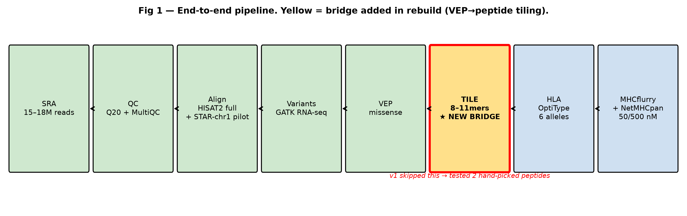
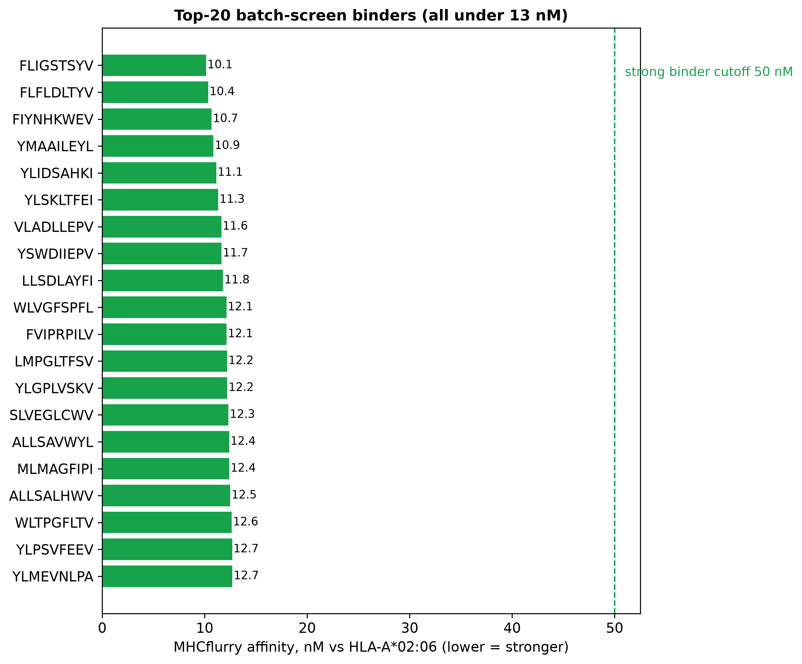
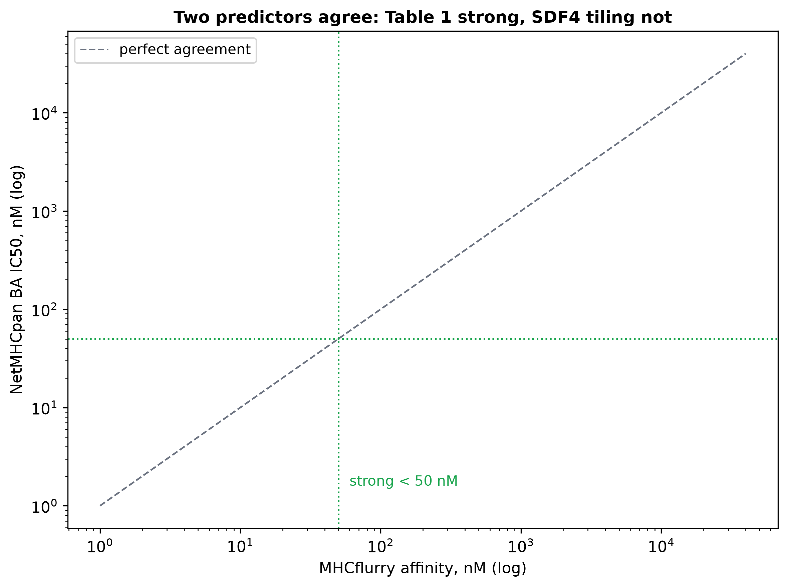
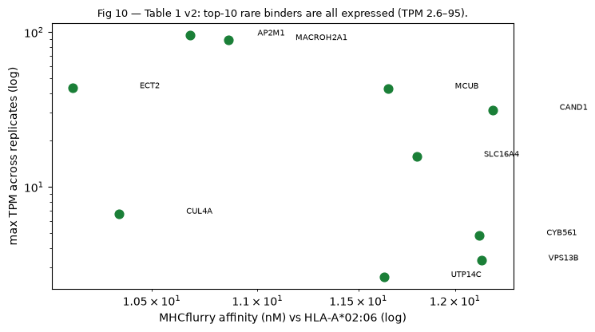
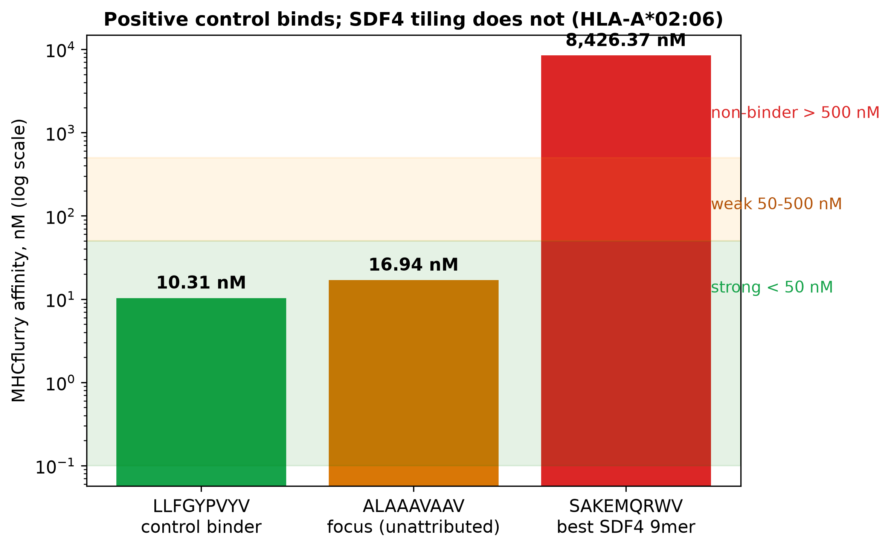
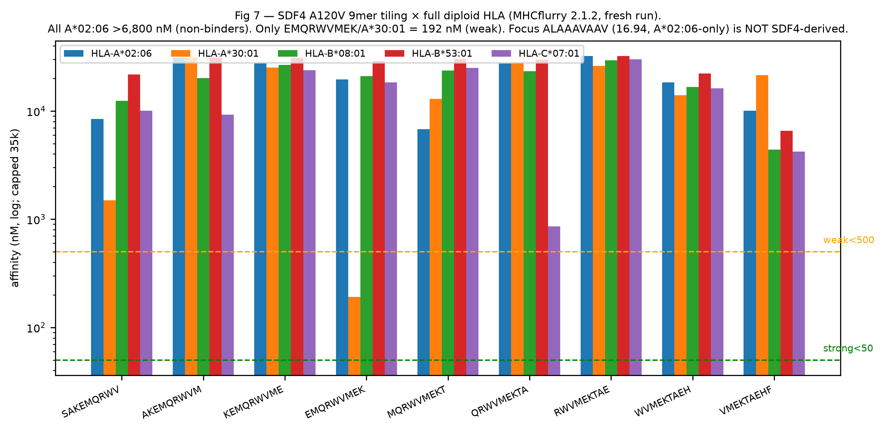
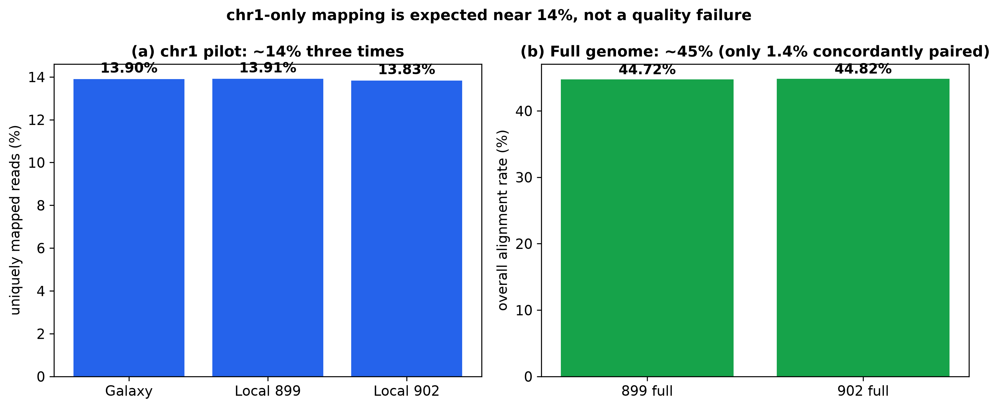
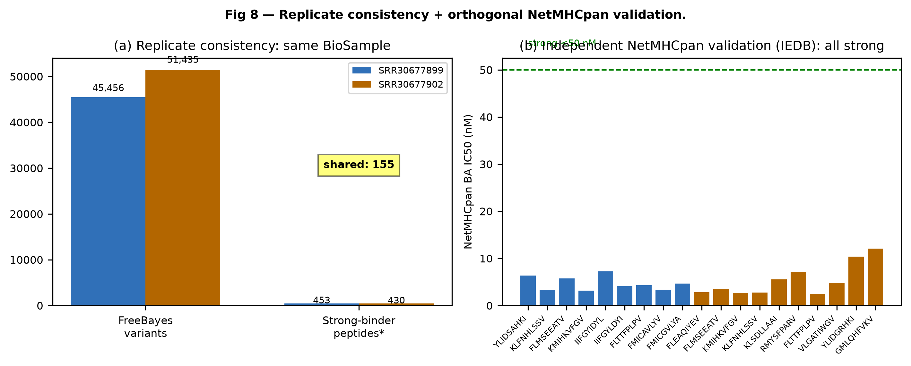

# GBM-Personalized-NeoAntigen-Vaccine

[](LICENSE)
[](08_Reproducibility/gbm-pub.yml)
[](https://www.ncbi.nlm.nih.gov/bioproject/PRJNA1161693)
[](08_Reproducibility/LIMITATIONS_AND_FUTURE_DIRECTIONS.md)

An evidence-first, end-to-end neoantigen discovery and prioritisation pipeline for
glioblastoma from tumour RNA-seq — with every filtering step counted, every figure
generated from checked-in tables, and every negative result reported.



## Introduction

Personalised cancer vaccines built from a patient's own tumour mutations are among
the most promising approaches for glioblastoma (GBM), an aggressive brain cancer
with few treatment options (Keskin et al., Nature 2019; Hilf et al., Nature 2019).
The concept is straightforward — find mutated protein fragments the immune system
can recognise — but doing it rigorously from RNA sequencing requires variant
calling, HLA typing, peptide tiling, binding prediction, germline filtering and
expression gating, each of which can silently fail. This repository implements that
full chain on a GBM patient-derived xenograft dataset, audits each step against
independent evidence, and publishes both what survived and what did not.

## Pipeline summary

Starting from two RNA-seq runs of the same BioSample (technical replicates), the
pipeline performs:

- Data acquisition (`01_Data/fetch.sh`) — `prefetch` + `fasterq-dump` (SRA Toolkit)
- Quality control (`02_QC/run_qc.sh`) — `FastQC`, `Trim Galore` (Q20/len20/2-colour)
- Alignment (`03_Alignment/run_align.sh`) — `STAR` (chr1 pilot) + `HISAT2` (full genome)
- Variant calling (`04_Variants/run_variants.sh`) — `Picard` + `GATK` RNA-seq chain
  (plus an archived independent FreeBayes call for two-caller comparison)
- Germline filtering (`04_Variants/filter_gnomad.py`) — dbSNP rsID proxy via Ensembl VEP REST
- HLA typing (`05_HLA/run_hla.sh`) — `OptiType` RNA mode, full diploid call
- Peptide tiling (`04_Variants/vep_to_peptides.py`) — missense variants → 8–11mers
- Binding prediction (`06_Neoantigens/run_predict.sh`) — `MHCflurry` across all
  patient alleles + `NetMHCpan` via the IEDB API (`fetch_iedb.py`)
- Expression gating (`06_Neoantigens/run_expression.sh`) — `StringTie` TPM ≥ 1
- TESLA-style audit (`06_Neoantigens/tesla_audit.py`) — affinity ≤ 34 nM,
  abundance, second-predictor confirmation per candidate

## Key results

- **Table 1** (`06_Neoantigens/Table1v2_expressed.csv`): 1,083 rare strong binders
  after germline filtering; top 10 (ECT2, CUL4A, AP2M1, …) all bind under 13 nM on
  HLA-A\*02:06, are tumour-expressed (TPM 2.6–95), and pass TESLA presentation
  filters 10/10 with NetMHCpan confirmation (IC50 2.4–14.6 nM).

  
  
  

- **Audited negative:** the previously reported SDF4 lead fails three independent
  checks (≤2 supporting reads at QUAL~0, absent from the second caller, known
  germline SNP) and its 9mers do not bind on any patient allele by either predictor.

  
  

- **Methods checks:** chr1 mapping reproduces three times (~13.9%); full-genome
  alignment reaches ~44.7% with the short-read pairing limit quantified; HLA
  re-typing reproduces exactly on the high-coverage replicate.

  
  

## Usage

> [!NOTE]
> Raw sequencing data and reference genomes are git-ignored and fetched on first
> run into `data-RUNTIME/`, `refs-RUNTIME/`, `results-RUNTIME/`. Curated tables and
> figures ship with the repo, so verification works without downloading anything.

```bash
# 1. environment (pinned)
conda env create -f 08_Reproducibility/gbm-pub.yml
conda activate gbm-pub

# 2. data → QC → alignment → variants → HLA (needs downloads, ~hours)
bash 01_Data/fetch.sh
bash 02_QC/run_qc.sh
bash 03_Alignment/run_align.sh
bash 04_Variants/run_variants.sh
bash 05_HLA/run_hla.sh

# 3. prediction → expression gating → audits (needs models/APIs)
bash 06_Neoantigens/run_predict.sh
bash 06_Neoantigens/run_expression.sh
python3 06_Neoantigens/tesla_audit.py

# 4. verify every figure from checked-in tables (no downloads needed)
for f in 07_Figures/make_fig*.py; do python3 "$f"; done
```

See `08_Reproducibility/METHODS.md` for parameters and
`08_Reproducibility/VALIDATION.md` for the evidence log behind every claim.

## Repository layout

`01_Data/` → `02_QC/` → `03_Alignment/` → `04_Variants/` → `05_HLA/` →
`06_Neoantigens/` → `07_Figures/` → `08_Reproducibility/` → `09_Manuscript/`

Each numbered stage holds its scripts, evidence tables and a `NOTE.md` summary.
The full map, including what was deliberately excluded, is in
`08_Reproducibility/ORGANIZATION.md` and `EVIDENCE_MANIFEST.md`.

## Reproducibility

- Environment pinned: `08_Reproducibility/gbm-pub.yml`, `config.yaml`.
- One generator script per figure; all PNGs regenerate from checked-in tables.
- Audit trail: `PIPELINE_AUDIT.md` (defects found and fixed),
  `NATURE_CELL_BENCHMARK.md` (standing vs published literature),
  `ALTERNATIVE_METHODS.md` (what the field would use instead).

## Limitations

Computational evidence only — no candidate should move toward patients without
Sanger confirmation, DNA-based HLA typing and T-cell assays. The eight explicit
boundaries and the path to close each are in
`08_Reproducibility/LIMITATIONS_AND_FUTURE_DIRECTIONS.md`. Key ones: tumour-only
design (no matched normal), 9mer/class-I-only screen, RNA-based HLA at low depth.

## Citations

Methods and predictors used here — please cite them alongside this repo:

- Keskin et al. **Neoantigen vaccine generates intratumoral T cell responses in
  phase Ib glioblastoma trial.** _Nature_ 565:234–239 (2019).
  doi:[10.1038/s41586-018-0792-9](https://doi.org/10.1038/s41586-018-0792-9)
- Hilf et al. **Actively personalized vaccination trial for newly diagnosed
  glioblastoma.** _Nature_ 565:240–245 (2019).
  doi:[10.1038/s41586-018-0810-y](https://doi.org/10.1038/s41586-018-0810-y)
- Wells et al. **Key parameters of tumor epitope immunogenicity revealed through a
  consortium approach improve neoantigen prediction.** _Cell_ 183 (2020).
  doi:[10.1016/j.cell.2020.09.015](https://doi.org/10.1016/j.cell.2020.09.015)
- Hundal et al. **pVACtools: A computational toolkit to identify and visualize
  cancer neoantigens.** _Cancer Immunol Res_ 8:409–420 (2020).
  doi:[10.1158/2326-6066.CIR-19-0401](https://doi.org/10.1158/2326-6066.CIR-19-0401)
- Szolek et al. **OptiType: precision HLA typing from NGS data.** _Bioinformatics_
  30:3310–3316 (2014). doi:[10.1093/bioinformatics/btu548](https://doi.org/10.1093/bioinformatics/btu548)
- O'Donnell et al. **MHCflurry 2.0.** _Cell Syst_ 11:42–48 (2020).
  doi:[10.1016/j.cels.2020.06.010](https://doi.org/10.1016/j.cels.2020.06.010)
- Reynisson et al. **NetMHCpan-4.1.** _J Proteome Res_ 19:3115–3124 (2020).
  doi:[10.1021/acs.jproteome.0c00054](https://doi.org/10.1021/acs.jproteome.0c00054)

If you use this repository, cite it via `CITATION.cff`.

## License

MIT — see [LICENSE](LICENSE).

## Contact

Questions or issues: please open a
[GitHub issue](https://github.com/Nurulamin6191/GBM-Personalized-NeoAntigen-Vaccine/issues).
